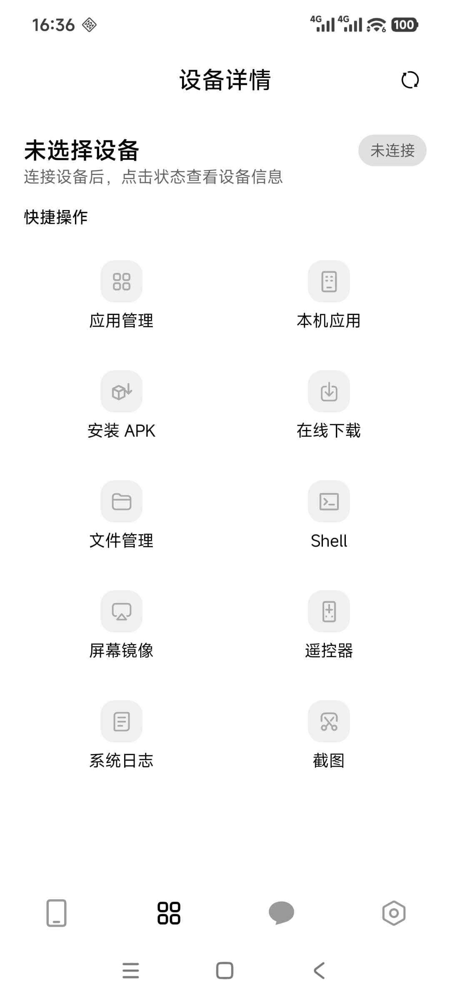

# sky adb

  

sky adb 是一款运行在 Android 手机上的 ADB 管理工具，用于通过 IPv4/IPv6 WiFi ADB、Wireless Debugging 或 USB OTG 管理手机、平板、电视和盒子。

## 功能特性

- 无线调试配对、连接、断开和最近设备记录
- 扫描 Android 无线调试配对二维码，自动查找配对端口并完成连接
- 为当前 Wi-Fi 连接生成二维码，其他设备使用 sky adb 扫码即可连接
- USB OTG 连接 ADB / Fastboot；Fastboot 支持设备摘要、重启快捷按钮、命令查询和结果复制
- 局域网自动发现和网段扫描，快速发现 adb 设备
- 查看设备基础信息、连接状态和截图
- 应用列表、分类筛选、搜索、启动、停止和卸载
- 本地 APK 安装，在线下载 APK 后安装到目标设备
- 本机用户应用导出并安装到目标设备
- 在线下载文件并推送到目标设备
- 目标设备文件管理、目录浏览、本地文件上传和设备文件下载
- 设备截图预览，需要时再保存到本机
- 目标设备系统日志查看和复制
- 模拟物理按键、虚拟遥控器和低延迟屏幕镜像；镜像支持 H.264/H.265 编码器选择和实时性能统计
- 查看目标设备前置/后置摄像头画面（目标设备需为 Android 12 或更高版本并支持摄像头镜像）
- 实时查看目标设备电池、CPU、内存、存储、网络、亮度、当前应用和进程状态
- Shell 命令执行和输出查看
- AI 助手：接入 OpenAI 兼容模型，通过AI操作设备
- 诊断日志记录错误信息，便于排查连接和功能异常
- 默认端口、连接超时、命令超时、镜像画质、镜像编码器和主题设置

## 如何使用

1. 无线连接：在目标设备开启开发者选项和无线调试，在 sky adb 中输入 IPv4/IPv6 地址和 ADB 端口，或先进行无线调试配对。IPv6 带端口时使用 `[地址]:端口`。
2. USB 连接：使用支持数据传输的 OTG 线连接，允许本机访问 USB 设备，并在目标设备确认 USB 调试授权；Fastboot 模式可直接从 USB OTG 列表连接。
3. 连接成功后进入设备详情页，使用应用管理、APK 安装、文件管理、截图、遥控器、屏幕镜像或 Shell 等功能。
4. 常用 WiFi 设备会自动保存到最近设备列表，后续可快速回填连接信息。

屏幕镜像的控制区可以隐藏，输入键盘默认关闭，可通过顶部键盘按钮独立打开和关闭。镜像默认使用 H.264，可在设置中切换 H.265；WiFi 镜像优先使用专用 ADB 连接，失败时自动回退。控制区可见时会显示实时传输方式、解码器、码率、解码帧率、队列深度、丢帧和流水线延迟统计。

## 预览

---

## 技术栈

- Kotlin
- Jetpack Compose
- Miuix 0.9.4
- Kadb 2.1.5 + kadb-mdns 2.1.4
- scrcpy-server 5.0.1
- Coroutines / Flow
- DataStore
- OkHttp
- Koog
- enriched-markdown

## 参考实现

扫码连接、连接分享二维码、系统状态监控和摄像头预览功能参考了
[CN-QiuWan/SkyADB-Pro](https://github.com/CN-QiuWan/SkyADB-Pro) 的功能设计；
本项目的页面布局、组件和交互均沿用 sky adb 自身的 Compose/Miuix 风格实现。

详细实现、构建验证和维护规范见 [项目文档](docs/README.md)。
